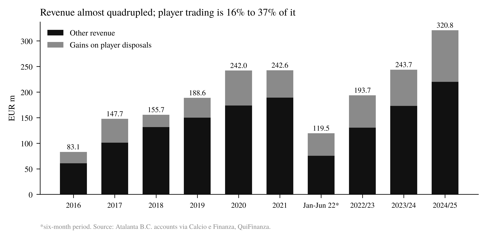
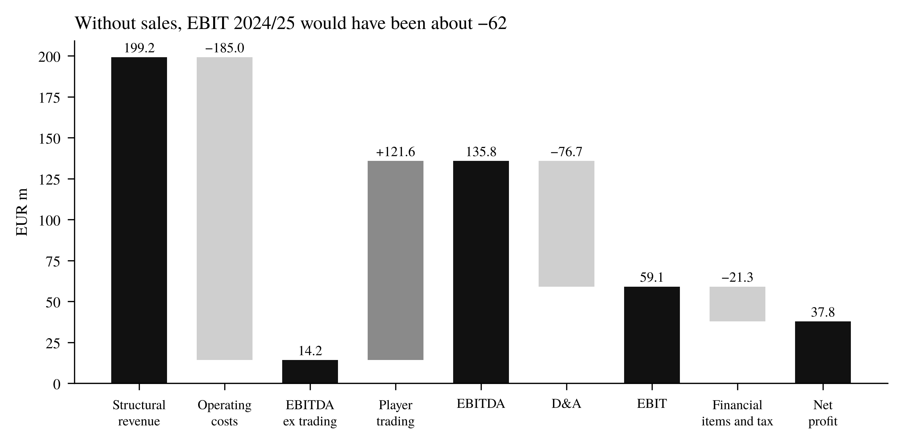
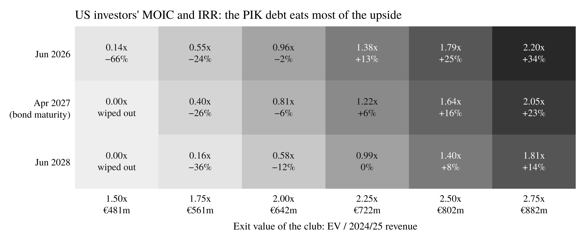

# Between Sustainability and Competitiveness: the Atalanta Model

Independent research project by **Ettore Mancuso**.

- **Paper (English, A4, 16 pages):** [`paper/atalanta_model.pdf`](paper/atalanta_model.pdf)
- **Report (Italian, 15 pages):** [`report/atalanta_model_report_it.pdf`](report/atalanta_model_report_it.pdf)
- **Notebook:** [`notebooks/atalanta_model.ipynb`](notebooks/atalanta_model.ipynb)
- **LBO model (Excel):** [`model/atalanta_lbo.xlsx`](model/atalanta_lbo.xlsx), printable view in [`model/atalanta_lbo_print.pdf`](model/atalanta_lbo_print.pdf)

## The question

Atalanta closed every financial year of the Gasperini era (2016 to 2024/25) in profit, in a league that loses money as a whole: Serie A lost EUR 369m in 2023/24. My thesis is that for Atalanta selling players is the core business, not a one-off. The project reads ten years of financial statements to test that, and to see where the model could break.

## What the analysis covers

1. **Revenue and player trading.** How much of revenue comes from gains on player disposals (plusvalenze), year by year.
2. **Accounting.** How a gain on disposal is booked under Italian GAAP (OIC 24): registration rights are capitalised, amortised over the contract, and the gain is price minus net book value. Worked example: Koopmeiners.
3. **Profit bridge 2024/25.** From structural revenue to net profit, with player trading taken out of EBITDA and EBIT.
4. **Balance sheet.** Equity growth, financial debt, cash, and how much of the equity was built from retained profits.
5. **Ownership.** The 2022 entry of Stephen Pagliuca's group, read as a private equity deal: holding structure, PIK bond, implied multiples, MOIC and IRR for the Percassi family, and an **LBO model of the American investors' returns**, built both in Python and as an Excel model (sources and uses, operating model, PIK debt schedule, returns, breakeven exit value, 5×5 sensitivity tables and model checks).
6. **After Gasperini.** The first half of 2025/26 and the largest sales in the club's history.

## Main results

| | |
|---|---|
| Consecutive years in profit | 10 (2016 to 2024/25) |
| Cumulative net profit | EUR 230.5m |
| Cumulative gains on player disposals | EUR 534m, 27.5% of revenue |
| Revenue | EUR 83.1m (2016) to 320.8m (2024/25), CAGR 17% |
| EBIT 2024/25 without player trading | about EUR −62m (reported EBIT: 59.1m) |
| Equity, Dec 2019 to Dec 2025 | EUR 77.8m to 275.6m; about 90% of the growth to June 2025 comes from retained profits |
| Net result 2024/25 | EUR 37.9m, first in Serie A |
| Pagliuca deal, debt at the holding | 83% of the entry price; with PIK interest the club must be worth about 2.1x revenue by April 2027 for the US equity to break even |







## Repository structure

```
atalanta-business-model/
├── data/                               # hand-collected from published accounts, one source per row
│   ├── financials_by_period.csv        # revenue, gains on disposals, net profit, 2016 to 2024/25
│   ├── pnl_2024_25.csv                 # income statement 2024/25 vs 2023/24
│   ├── equity.csv                      # shareholders' equity, Dec 2019 to Dec 2025
│   ├── serie_a_net_results_2024_25.csv
│   └── top_player_sales.csv            # ten largest gains on disposal (press estimates flagged)
├── src/
│   ├── club_finance.py                 # trading share, CAGR, book value, profit bridge
│   └── pe_returns.py                   # holding-company LBO: sources and uses, PIK debt, MOIC, IRR
├── tests/                              # pytest checks on the data and the functions (GitHub Actions)
├── notebooks/atalanta_model.ipynb      # full analysis, executed
├── figures/                            # PDF and PNG charts
├── outputs/                            # CSV exports for Excel or Power BI
├── paper/                              # LaTeX source and PDF of the paper (English)
├── model/                              # Excel LBO of the Pagliuca deal (formulas, sensitivities, chart)
└── report/                             # written report (PDF)
```

## How to run

```bash
pip install -r requirements.txt pytest
pytest -q
jupyter nbconvert --to notebook --execute --inplace notebooks/atalanta_model.ipynb
```

The paper compiles with XeLaTeX (font: TeX Gyre Termes): `cd paper && xelatex atalanta_model.tex` (twice).

## Data notes

* **Sources.** Atalanta B.C. financial statements as reported by Calcio e Finanza, plus QuiFinanza for the 2016 to 2022 gains on disposals. Each CSV has a `source` column with the link. The full source list is at the end of the paper and of the report.
* **Calendar.** Until 2021 the financial year ended on 31 December. The club then filed a six-month period (January to June 2022) and moved to a July to June year. The six-month period is included in the totals and flagged in the charts.
* **Restatements.** For 2022/23 and 2023/24 I use the figures as restated in the following year's accounts (net profit 5.6m and 11.8m; some sources give 3.8m and 9.8m).
* **Estimates.** Gains on the 2026 sales (Palestra, Ahanor, Lookman) are press estimates and are not in the accounts yet. MOIC, IRR, multiples and the profit bridge are my own calculations.

## Tools and AI use

Python (pandas, SciPy, matplotlib), Excel, Jupyter, pytest, LaTeX, Git.
I used AI assistants for parts of the code and for the layout of the paper and the Excel model. The research question, the choice of data, the accounting reading and the conclusions are my own, and I can walk through every number.

## License

All rights reserved, © 2026 Ettore Mancuso. You are welcome to read the code and reproduce the results; reuse or redistribution requires my written permission. See [LICENSE](LICENSE). Atalanta B.C. is not affiliated with this project.
